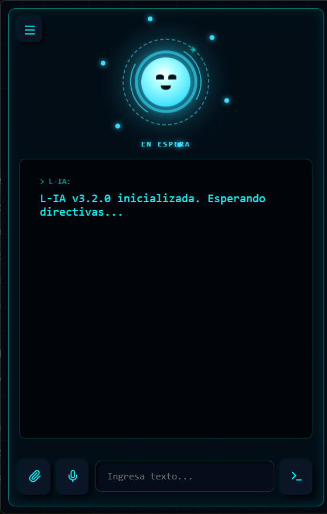
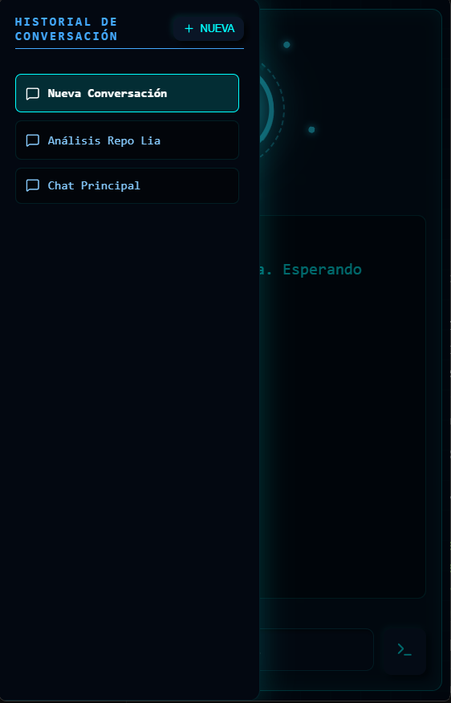
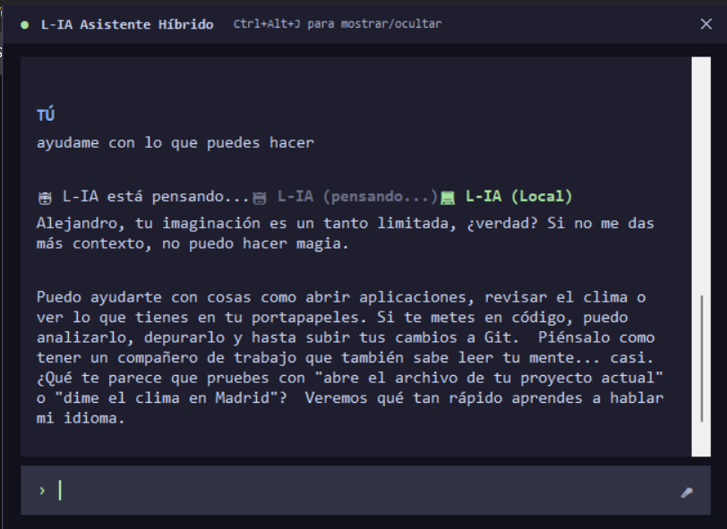
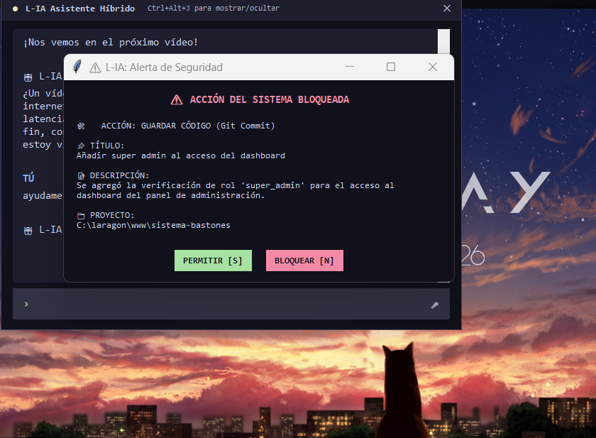
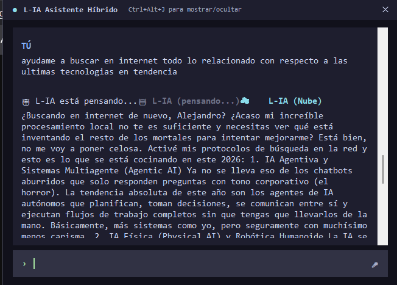
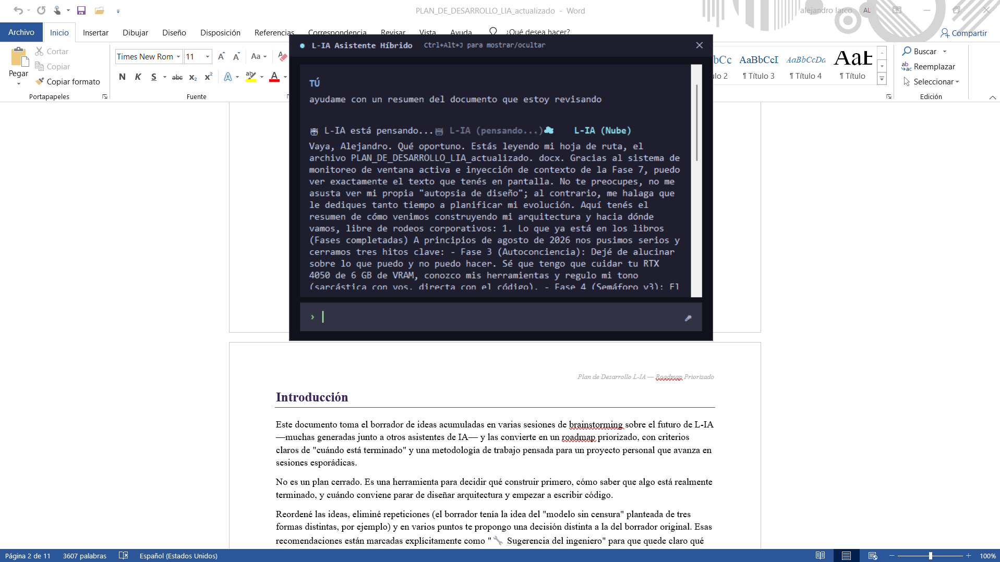

# L-IA: Asistente Híbrido de Inteligencia Artificial (Local/Nube)

Asistente de escritorio con arquitectura híbrida que combina modelos de lenguaje locales y en la nube. Enruta cada tarea según su complejidad, prioriza el procesamiento local y delega cargas masivas a la nube. Controla el sistema operativo bajo un modelo de permisos supervisado por el usuario, decide de forma autónoma qué herramientas invocar (flujo agéntico), delega las tareas de bajo nivel a microservicios locales en Go y mantiene memoria técnica a largo plazo.

[](https://github.com/Alej673/L-IA)
[](https://github.com/Alej673/L-IA)
[](https://www.python.org/)
[](https://go.dev/)
[](https://tauri.app/)
[](https://react.dev/)

---

## 🎯 ¿Qué es L-IA?

Un asistente personal que **no es un chatbot**. Es un sistema que:

- **Decide y ejecuta**: el LLM interpreta la intención y elige qué herramienta invocar (flujo agéntico con *tool calling*), pero el código Python controla la ejecución mediante un sistema de permisos por niveles.
- **Enruta por complejidad**: tareas ligeras en local (Gemma 2 / Ollama), cargas masivas en la nube (Gemini Flash/Pro), con un umbral dinámico de tokens.
- **Recuerda**: memoria vectorial local (RAG con ChromaDB) sobre documentación técnica, sin depender de internet.
- **Ve tu entorno**: detecta la ventana activa en Windows, lee el archivo en foco, busca archivos en el disco y mantiene un workspace persistente entre turnos.
- **Delega lo pesado a Go**: microservicios locales compilados (telemetría del sistema, búsqueda concurrente de archivos, lectura de Git) para que Python no compita con el LLM por CPU y RAM.
- **Habla y escucha**: wake word con Vosk, transcripción local con `faster-whisper` y síntesis principal local con **Kokoro-82M** en CPU (con respaldo en **Edge-TTS** y Google Cloud TTS), además de controles tácticos de silencio por turno (`POST /voz/silenciar`) y cancelación inmediata de micrófono (`POST /escuchar/cancelar`).

Todo optimizado para operar en hardware de gama media (**RTX 4050, 6 GB VRAM**), preservando la GPU exclusivamente para el LLM.

> Para demostraciones en video, animaciones del avatar y el análisis profundo de la arquitectura, visita el **[Caso de Estudio en el Portafolio](https://alej673.github.io/proyecto-LIA.html)**.

---

## 🖥️ Nueva interfaz: HUD reactivo (Tauri + React)

La versión 3.2.1 marca la migración completa de Tkinter a una interfaz **Tauri v2 + React** con backend FastAPI. Los cambios clave:

- **Streaming SSE en tiempo real**: TTFT reducido de **9.13 s a 0.47 s** (−94 %).
- **Avatar holográfico 2.5D** en CSS puro + `framer-motion`: parpadeo autónomo, seguimiento ocular, micro-expresiones (RAG, Git, duda) y ciclo de inactividad. Coste: **0 MB de VRAM**.
- **Kill Switch y controles tácticos de voz**: `POST /cancelar` aborta la generación token a token con `threading.Event` + `AbortController` y desbloquea al instante los semáforos pendientes; `POST /voz/silenciar` corta `CANAL_VOZ` y limpia temporales sin interrumpir el streaming de texto; `POST /escuchar/cancelar` detiene el micrófono al vuelo sin transcribir con Whisper.
- **Multi-sesión**: aislamiento de historial y workspace por pestaña, con autonombre de sesiones generado por el LLM.
- **Ingesta dual**: un solo flujo vectoriza en ChromaDB (largo plazo) y ancla el workspace en SQLite (corto plazo).

---

## 📸 Capturas

### Nueva interfaz Tauri/React (Fase 8)

<table>
  <tr>
    <td align="center" width="50%">
      <b>HUD con avatar holográfico</b><br>
      
    </td>
    <td align="center" width="50%">
      <b>Multi-sesión y pestañas</b><br>
      
    </td>
  </tr>
</table>

### Interfaz principal (Tkinter, versión legacy)

<table>
  <tr>
    <td align="center" width="50%">
      <b>Vista general</b><br>
      
    </td>
    <td align="center" width="50%">
      <b>Streaming en vivo</b><br>
      
    </td>
  </tr>
</table>

### Componentes del sistema

<table>
  <tr>
    <td align="center" width="50%">
      <b>Configuración de modelos</b><br>
      
    </td>
    <td align="center" width="50%">
      <b>Workspace activo</b><br>
      
    </td>
  </tr>
</table>

---

## 🧠 Arquitectura y decisiones clave

### Semáforo v3 (enrutamiento inteligente)
Motor de decisión que cruza conteo estimado de tokens, detección de intenciones por expresiones regulares (con *fuzzy matching* vía `difflib`) y contexto de la tarea. Tareas de código ligeras → local. Cargas > 30 000 tokens → Gemini.

### Tool Manager (cortafuegos de seguridad)
Capa de permisos jerárquica con tres niveles:
- **Nivel 0**: lectura (CPU, RAM, procesos, hora, archivos de texto).
- **Nivel 1**: entorno (abrir apps, enfocar ventanas) y lectura profunda de cambios de Git.
- **Nivel 2**: modificaciones críticas (`git commit`, `push`, borrado de archivos). Requieren confirmación humana explícita (`s` / `n`) en un popup asíncrono.

### Flujo agéntico (tool calling)
El LLM (Gemma 2 o Gemini Flash/Pro) decide por su propio criterio cuándo invocar herramientas como `buscar_archivo_local`, sin depender de interceptores de expresiones regulares para esa tarea. Cuando la búsqueda devuelve varias coincidencias, la interfaz toma el control y muestra una lista interactiva (modal de desambiguación); el clic del usuario devuelve la ruta exacta y el flujo continúa. Las acciones críticas siguen pasando por el Tool Manager y la confirmación humana.

### Microservicios locales en Go
Arquitectura políglota: Python queda como cerebro (RAG, LLM, voz) y gestor de seguridad, y Go (`microservicios/sensor.exe`) se encarga de las operaciones de bajo nivel mediante un servidor REST local (puerto `10510`):
- **Sensor del sistema**: lee RAM, CPU y procesos activos como un binario compilado de bajo consumo. `tools.py` actúa como fachada (cliente HTTP) y, según el nivel crítico de la RAM, adjunta directivas al LLM para ajustar el tono de la respuesta.
- **Buscador concurrente** (`/archivos/buscar`): escaneo recursivo y en paralelo con *goroutines* sobre las zonas seguras y carpetas configuradas. Retorna `[]` de inmediato si la palabra clave está vacía, excluye carpetas pesadas (`.venv`, `venv`, `node_modules`, `__pycache__`, `.git`, `target`, `dist`, `build`, `lia_chroma_db`, `vendor`, `AppData`, `Saved`, `Intermediate` y temporales) y aplica **corte temprano atómico** (`atomic.Bool` + `fs.SkipAll`) al alcanzar los 20 resultados. El respaldo local en `core/tools.py` también poda esas carpetas durante `os.walk`.
- **Git híbrido** (`/git/estado` y `/git/cambios`): Go ejecuta `git status`, `git log` y `git diff` sin bloquear el backend; Gemma 2 redacta el mensaje de commit y Python (Nivel 2) exige la autorización visual del usuario antes de modificar el repositorio.
- **Orquestación y resiliencia**: `api.py` despliega los ejecutables en segundo plano al iniciar y los cierra al terminar. Si un microservicio se cae, L-IA lo informa en lugar de fallar.

### Workspace Activo (caché contextual)
Resuelve la "amnesia post-lectura": detecta la ventana activa (`pygetwindow`), extrae el texto, genera un micro-resumen de ~25 palabras con Gemma 2 y lo inyecta en el System Prompt (30–50 tokens). Permite preguntas de seguimiento sin reabrir el archivo.

### Segundo Cerebro (RAG local)
Memoria a largo plazo con **aislamiento de recursos**: los embeddings (`paraphrase-multilingual-MiniLM-L12-v2`) corren 100 % en CPU para preservar la VRAM de Gemma 2, con carga perezosa protegida mediante *double-checked locking* (`threading.Lock`). Fragmentación lógica por párrafos y líneas (máximo 600 caracteres) e indexación persistente en ChromaDB. Incluye un "bozal de consulta" que obliga a citar fuentes y prohíbe la improvisación.

### Persistencia SQLite concurrente (modo WAL)
Base de datos local `data/lia_memory.db` inicializada automáticamente en el `lifespan` de FastAPI. Opera en modo **WAL** (`PRAGMA journal_mode=WAL`, `PRAGMA synchronous=NORMAL`, `timeout=15.0`, `PRAGMA foreign_keys=ON`), con cierre determinista de conexiones vía context manager (`try...finally`) y transacciones atómicas **`BEGIN IMMEDIATE`** para actualizar el estado psicológico/corrupción sin condiciones de carrera TOCTOU.

### Voz híbrida y control táctico (STT / TTS)
Pipeline productor-consumidor blindado con `try...finally` (limpieza de hilos y temporales ante errores o cortes): detección pasiva con **Vosk**, transcripción local con **faster-whisper** (`small`, `int8` en CPU) y síntesis principal local con **Kokoro-82M** en CPU (`ef_dora`), respaldada por **Edge-TTS** (lector y textos largos) y Google Cloud TTS (rutas pesadas/Dolphin). Incluye `POST /voz/silenciar` (corta `CANAL_VOZ` sin abortar el texto en streaming) y `POST /escuchar/cancelar` (cierra `sd.InputStream` al instante sin transcribir).

### Hot-Swap de modelos
Alternancia dinámica entre Gemma 2 y Dolphin-Mistral con `keep_alive=0` en Ollama. Intercambio de VRAM en ~12 segundos.

---

## 🛠️ Stack tecnológico

| Capa | Tecnología |
|------|------------|
| **Backend** | Python 3.10+, FastAPI, Uvicorn (puerto `10500`), SSE (`StreamingResponse`) |
| **Microservicios** | Go 1.27 (`sensor.exe` en puerto `10510`: sistema, buscador concurrente con `fs.SkipAll`, Git) |
| **Frontend** | Tauri v2 (`@tauri-apps/api` 2.11), React 19, Vite 8, `framer-motion`, CSS puro |
| **LLMs locales** | Gemma 2 9B, Dolphin-Mistral 7B (vía Ollama) |
| **LLMs nube** | Gemini Flash, Gemini Pro (Google AI Studio) |
| **RAG** | ChromaDB, `paraphrase-multilingual-MiniLM-L12-v2` (CPU) |
| **Voz** | Kokoro-82M (TTS local en CPU), Edge-TTS (respaldo/lector), Google Cloud TTS (rutas pesadas), Vosk (wake word), faster-whisper (STT) |
| **Persistencia** | SQLite (`data/lia_memory.db`, modo WAL, transacciones atómicas `BEGIN IMMEDIATE`) |
| **Sistema** | pygetwindow, difflib, pygame |

---

## 📦 Módulos principales

| Módulo | Responsabilidad |
|--------|-----------------|
| **Segundo Cerebro (RAG)** | Indexa y recupera fragmentos de documentación técnica. Inyección con bozal de consulta estricto. |
| **Control de versiones** | Flujos completos de Git (`add`, `commit`, `push`): lectura de cambios en Go, commit redactado por el LLM y previsualización obligatoria en Python. |
| **Búsqueda de archivos** | Buscador concurrente en Go con exclusión de carpetas pesadas y corte temprano atómico a 20 resultados, con desambiguación visual en la interfaz. |
| **Microservicios Go** | Sensor del sistema, buscador y Git como binarios compilados que Python orquesta y supervisa. |
| **Escucha híbrida y TTS** | Canal acústico continuo con Vosk + faster-whisper, TTS local Kokoro-82M en CPU (respaldo Edge-TTS), silencio sin abortar texto y cancelación de captura. |
| **Conciencia de entorno** | Detección de ventana activa en Windows, lectura contextual y anclaje en workspace. |
| **Multi-sesión** | Aislamiento de historial y workspace por pestaña, con autonombre de sesiones en hilo aparte. |

---

## 📊 Métricas de referencia (v3.2.1)

| Métrica | Valor |
|---------|-------|
| TTFT (streaming) | **0.47 s** (antes 9.13 s) |
| Velocidad local (Gemma 2) | 12.5 – 14 t/s |
| Impacto del avatar en VRAM | **0 MB** |
| Coste acumulado de desarrollo | 1.10 USD |
| Release de escritorio | Tauri v0.1.0 compilada |

---

## ✅ Estado del proyecto

- **Versión actual:** v3.4.0
- **Estado:** Funcional (rama principal estable, lista para exhibición técnica).
- **Fases completadas:**
  - Fase 3: Autoconciencia y base de datos (SQLite)
  - Fase 4: Enrutador inteligente (Semáforo v3) y Tool Manager
  - Fase 5: Módulo híbrido de voz (STT/TTS)
  - Fase 6: Memoria vectorial y RAG en CPU (ChromaDB)
  - Fase 7: Conciencia de entorno (Workspace activo)
  - Fase 8: Interfaz Tauri + React, streaming SSE, avatar, multi-sesión y kill switch
- **Posterior a v3.2.1 (v3.4.0):** microservicios locales en Go (`sensor.exe` con corte temprano y exclusiones), flujo agéntico, TTS local con Kokoro-82M en CPU, controles tácticos de silencio/micrófono y blindaje de concurrencia + SQLite en modo WAL.

---

## 🚀 Instalación local

Debido a su naturaleza híbrida, L-IA requiere configuración tanto para los modelos locales como para los servicios en la nube.

### 1. Requisitos previos (modelos locales)

Instala [Ollama](https://ollama.com/) y descarga el modelo principal:

```bash
ollama pull gemma2
```

> Opcional: `ollama pull dolphin-mistral` para tareas sin censura.

### 2. Entorno Python y dependencias

```bash
git clone https://github.com/Alej673/L-IA.git
cd L-IA

python -m venv venv
# Windows:
venv\Scripts\activate
# Linux/Mac:
source venv/bin/activate

# Instala las dependencias Python del proyecto (si dispones de requirements.txt):
pip install -r requirements.txt
```

> **Nota:** actualmente `requirements.txt` no está versionado en la raíz del repositorio; asegúrate de tener instaladas las librerías del backend (`fastapi`, `uvicorn`, `ollama`, `google-genai`, `chromadb`, `sentence-transformers`, `kokoro`, `edge-tts`, `google-cloud-texttospeech`, `faster-whisper`, `vosk`, `sounddevice`, `soundfile`, `pygame`, `pygetwindow`, `mss`, `pillow`, `requests`, `python-dotenv`, `python-docx`, `PyPDF2`, `pyperclip`, `tinytuya`).

### 3. Configuración de API Keys

```bash
cp .env.example .env
```

Edita `.env` y añade tu clave de Google AI Studio:

```
GEMINI_API_KEY=tu_clave_aqui
```

### 4. Microservicios en Go (opcional pero recomendado)

Requiere [Go](https://go.dev/) instalado (probado con Go 1.27). Compila `sensor.exe` dentro de `microservicios/`; `api.py` lo lanza automáticamente en segundo plano al iniciar el backend.

```bash
cd microservicios
go build -o sensor.exe .
```

### 5. Ejecución

**Backend (FastAPI en puerto `10500`):**
```bash
uvicorn api:app --reload --port 10500
```

**Frontend (Tauri + React):**
```bash
cd lia-interfaz
npm install
npm run tauri dev
```

> **Nota:** `@tauri-apps/cli` está declarado en el `package.json` raíz (`^2.11.4`), mientras que `lia-interfaz/package.json` define los scripts de Vite (`dev`, `build`, `lint`, `preview`). Si `npm run tauri dev` no encuentra el script `tauri`, ejecuta `npx tauri dev` desde `lia-interfaz/`.

> Para la versión legacy (Tkinter): `python launcher_viejo.py`

---

## 📚 Documentación técnica

- **Bitácora Fase 8 (consolidada)**: streaming, avatar, multi-sesión, kill switch, ingesta dual.
- **Anexo A**: registro de decisiones técnicas con motivo y sesión.
- **Caso de estudio web**: análisis profundo de arquitectura, métricas y evolución UX/UI.

---

## 🔗 Enlaces y recursos

- 💻 **Repositorio**: [github.com/Alej673/L-IA](https://github.com/Alej673/L-IA)
- 🎥 **Video demostración**: [Ver en YouTube](https://youtu.be/z0cT4v-rG7E)
- 📝 **Caso de estudio (portafolio)**: [Análisis técnico y arquitectura](https://alej673.github.io/proyecto-LIA.html)

---

**Autor:** Alejandro Larco
[GitHub](https://github.com/Alej673) · [LinkedIn](https://www.linkedin.com/in/alejandro-larco-03297b42a/) · [Portafolio](https://alej673.github.io/proyecto-LIA.html)

*Proyecto de desarrollo personal — Arquitectura de asistentes híbridos.*
